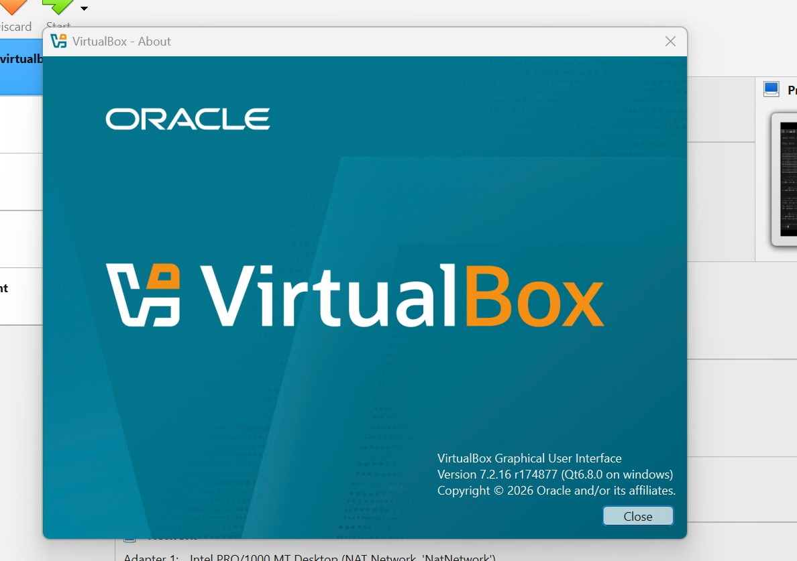
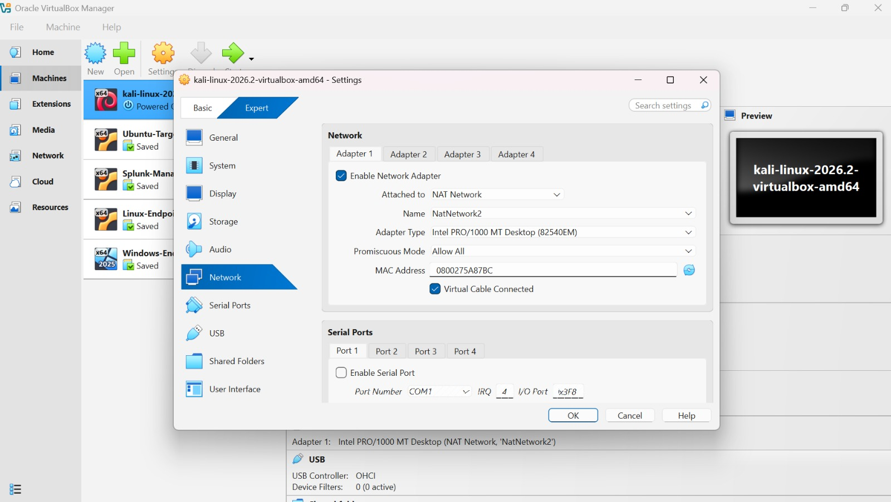
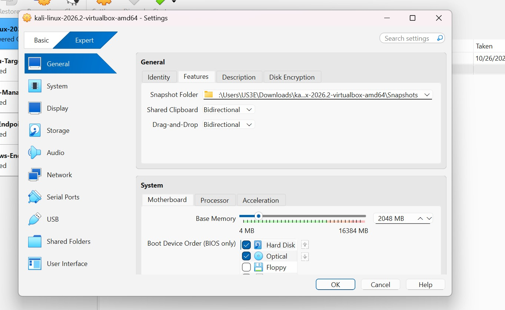
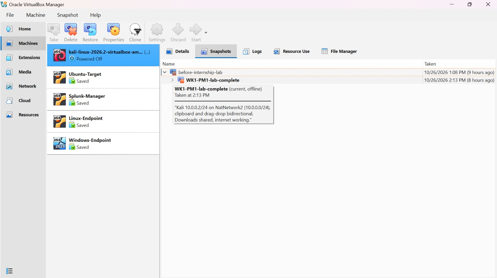
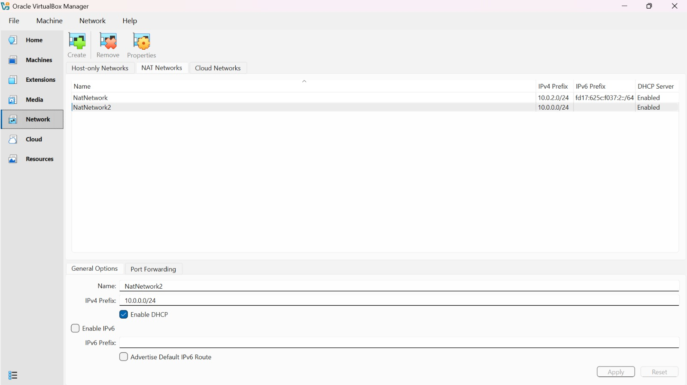
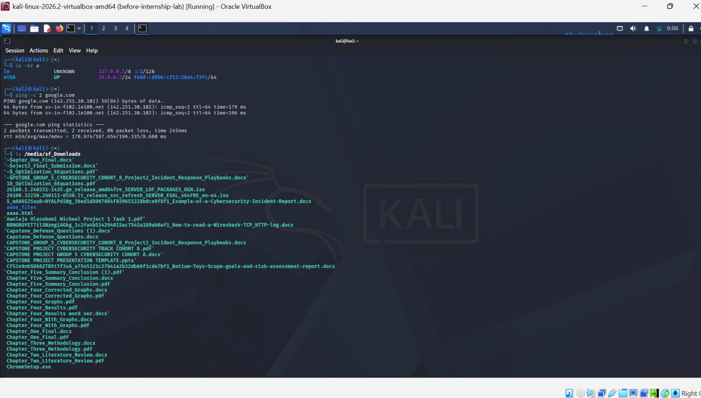
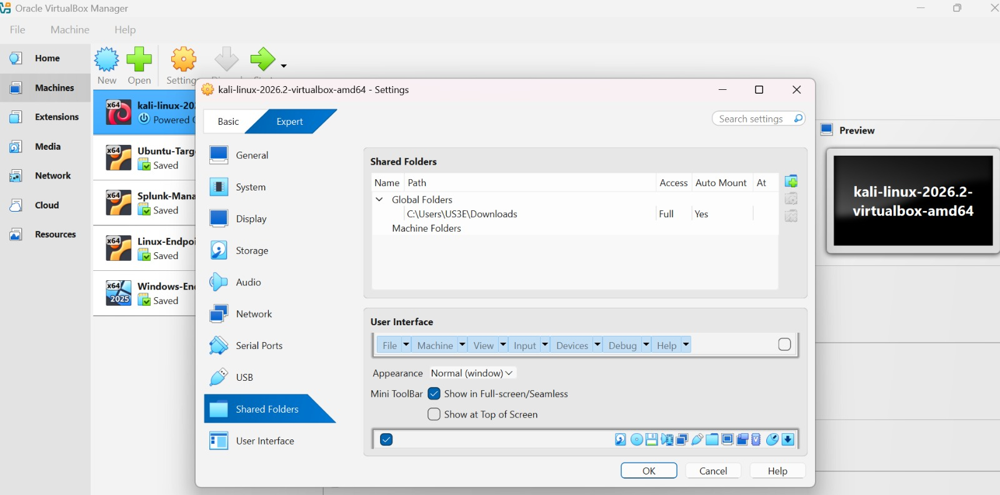

# 🔐 Cybersecurity Lab Environment Setup

**Building an isolated virtual lab for cybersecurity testing and ethical hacking practice**


**Author:** Nosiru | **Program:** Networkwalks Cybersecurity Internship, Batch B084 | **Week 1, Project Module 1**

---

## 📌 Project Overview

This project sets up a private virtual cybersecurity lab on my Windows computer using **VirtualBox** and **Kali Linux**.

The goal is a safe, controlled environment where security tools can be practiced without touching any real network. The lab sits on its own private virtual network, so more machines (Windows, Linux, Android) can be added later and used as practice targets.

> ⚠️ **Ethical use:** Everything in this project runs inside my own virtual lab on my own computer. Nothing here is used against any system I do not own or have written permission to test.

## 🎯 Requirements

| # | Requirement | Status |
|---|---|---|
| 1 | Use VirtualBox as the base (latest recommended version) | ✅ |
| 2 | Kali Linux set up as the attacker machine | ✅ |
| 3 | NAT Network in subnet 10.0.0.0/24 | ✅ |
| 4 | Clipboard and drag-and-drop enabled | ✅ |
| 5 | Host Downloads folder shared with the VM | ✅ |
| 6 | Kali Linux IP address set to 10.0.0.2/24 | ✅ |
| 7 | Kali Linux has full Internet access | ✅ |
| 8 | Snapshot taken | ✅ |

## 🧰 Lab Environment

| Item | Value |
|---|---|
| Host OS | Windows |
| Hypervisor | Oracle VirtualBox 7.2.16 |
| Attacker VM | Kali Linux 2026.2 |
| Network type | NAT Network (`NatNetwork2`) |
| Subnet | 10.0.0.0/24, DHCP enabled, IPv6 disabled |
| Kali IP | 10.0.0.2/24 (static) |
| Gateway | 10.0.0.1 |
| DNS | 8.8.8.8 |

## 🛠️ Steps I Followed

### Step 1: Check VirtualBox

I confirmed I was running VirtualBox **7.2.16**, the latest 7.2 release available to me.



### Step 2: Create the NAT Network (10.0.0.0/24)

A **NAT Network** puts all my VMs on one shared private network, so they can talk to each other and still reach the Internet through VirtualBox.

I already had a NAT Network on the default 10.0.2.0/24 range that other VMs of mine depend on, so I did **not** change it. Instead I created a second one, `NatNetwork2`, with:

- **IPv4 prefix:** 10.0.0.0/24
- **DHCP:** enabled
- **IPv6:** disabled



### Step 3: Take a safety snapshot first

Before changing anything on the existing Kali VM, I took a snapshot called `before-internship-lab`, so I could roll back if something broke.

### Step 4: Attach Kali to the new network

In the Kali VM settings (**Network, Adapter 1**):

- **Attached to:** NAT Network
- **Name:** NatNetwork2
- **Adapter type:** Intel PRO/1000 MT Desktop (82540EM)
- **Promiscuous mode:** Allow All (so tools like Wireshark can see all traffic on the lab network)
- **Cable connected:** ticked



### Step 5: Enable clipboard and drag-and-drop

In **Settings, General, Features**, I set both **Shared Clipboard** and **Drag-and-Drop** to **Bidirectional**, so copy/paste and file dragging work in both directions between Windows and Kali. I tested copy and paste both ways and it works.



### Step 6: Share the host Downloads folder

In **Settings, Shared Folders**, I added my Windows **Downloads** folder as a shared folder with **Auto-mount** and **Make Global** enabled. Inside Kali it appears at `/media/sf_Downloads`.



### Step 7: Set the static IP on Kali

Using **Edit Connections, Wired connection 1, IPv4 Settings**, I changed the method to **Manual** and entered:

| Field | Value |
|---|---|
| Address | 10.0.0.2 |
| Netmask | 24 |
| Gateway | 10.0.0.1 |
| DNS | 8.8.8.8 |

### Step 8: Test the network and Internet

```bash
ip -br a
ping -c 4 10.0.0.1
ping -c 4 8.8.8.8
ping -c 4 google.com
```

- `ip -br a` shows `eth0` with **10.0.0.2/24**
- The gateway replies, which proves the lab network works
- `8.8.8.8` replies, which proves Internet access
- `google.com` replies, which proves DNS works



### Step 9: Take the final snapshot

Once everything worked, I took a snapshot called `WK1-PM1-lab-complete`, which preserves the finished lab.



## 🧩 Troubleshooting: no IP address after setting the static IP

**Problem:** After switching Kali to a manual IP, `ip -br a` showed `eth0` as UP but with **no IPv4 address**, and pings failed with "Network is unreachable".

**Cause:** NetworkManager runs a *Duplicate Address Detection* check before using a manual address. On VirtualBox 7 with this Kali version, that check can stall, so the address is never assigned.

**Fix:** I turned off the wait and restarted the connection:

```bash
sudo nmcli connection modify "Wired connection 1" ipv4.dad-timeout 0
sudo nmcli connection down "Wired connection 1"
sudo nmcli connection up "Wired connection 1"
```

After that, `eth0` showed 10.0.0.2/24 and all the ping tests succeeded.

## 📚 What I Learned

- How **NAT**, **NAT Network** and host-only networking differ, and why a NAT Network suits a multi-machine lab
- How to read **CIDR notation**: what /24 means and how IP, netmask, gateway and DNS work together
- What **Guest Additions** enable (shared clipboard, drag-and-drop, shared folders)
- Why **snapshots** matter: a restore point before and after major changes
- A real troubleshooting workflow: read the symptoms (`ip -br a`, ping tests), find the layer that is failing, then apply a targeted fix
- Keeping existing work safe by adding a new network instead of changing one other VMs rely on

## 🚀 Next Steps

The lab is ready for further practice, including adding Windows and Linux target machines on the same network and running authorized scans and traffic analysis inside the lab.

---

*Completed as part of the Networkwalks Cybersecurity Internship (Batch B084).*
